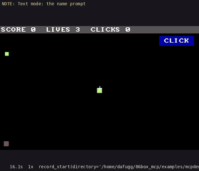
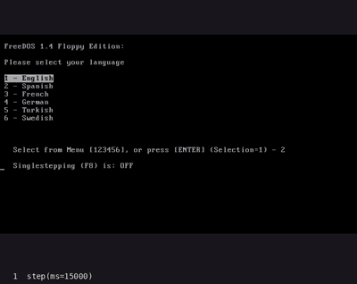
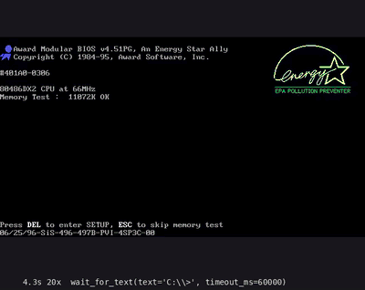
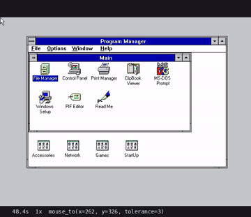
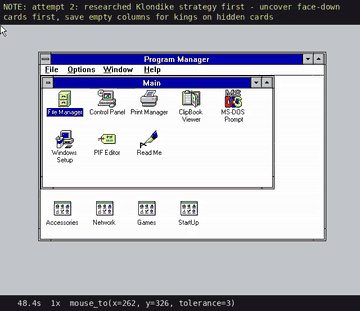
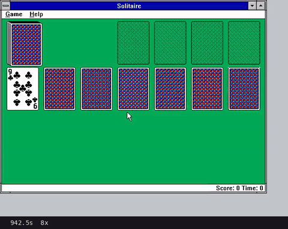
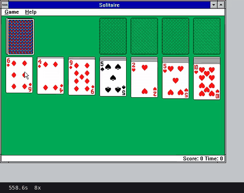
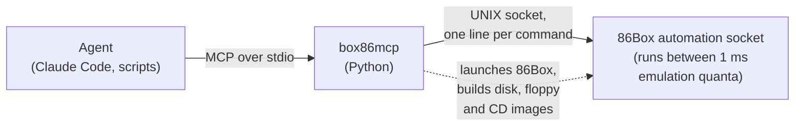

# 86box-mcp

**Let an AI agent, or your test suite, play, test and debug software on a
vintage PC emulated by [86Box](https://86box.net), with emulated time frozen
between moves.**

86box-mcp is an [MCP](https://modelcontextprotocol.io) server that drives an
emulated PC at the hardware level: keys on the emulated keyboard, the emulated
mouse, frames from the emulated video card, physical memory. Nothing runs
inside the guest, so it works from BIOS POST on, in any video mode, under any
OS. Its main targets are DOS games and tools. It runs headless (good for
servers and CI), or with the normal 86Box window if you want to watch.

It is built on an opt-in **automation socket** added to 86Box itself, on the
[`automation-socket` branch of our fork](https://github.com/dafugg/86Box/tree/automation-socket).
We will open a pull request to upstream 86Box soon.

> **Automating Windows 9x?** Use
> [V9x Remote Agent](https://github.com/michaeldale/V9x-Remote-Agent) instead.
> See [how they compare](#compared-with-v9x-remote-agent).

## Held time

An agent takes seconds to decide what to do; a DOS game runs at 35 or 70
frames per second. In **held** mode no emulated time passes between tool
calls, so a real-time game becomes turn-based:

```
act(hold_keys=["up", "ctrl"], ms=200)   # run forward, firing, for exactly 0.2 s of game time
                                        # → returns the frame at the end of those 0.2 s
```

The agent thinks as long as it needs, and the game never moves without it.
The same control makes runs repeatable: two cold boots driven by the same
inputs produce byte-identical frames. Steps run as fast as the host allows
(about 2× real time for a 486DX2-66 on an older Xeon).

## Examples

Everything below was driven through the MCP tools and recorded by 86Box
itself. The GIFs are short excerpts; `python -m box86mcp.ctl render-timeline` turns a
recording into a full video captioned with the MCP call in progress.

### A demo game with readable memory state



[`examples/mcpdemo`](examples/mcpdemo) is a small DOS game. The GIF shows
its driver testing keys, `mouse_to`, `write_memory` and timing, then a
~20-line bot playing with one `act()` call per frame. Every tick it publishes its
state to a block in conventional memory: player, enemy, coin and pointer
positions, score, lives, keys held. A pointer at `0000:04F0` says where the
block is. Tests read it with `read_memory` and `wait_for_memory` instead of
guessing from pixels, and can even post commands back into the block with
`write_memory`. The driver checks 34 exact results this way, including
movement per key press, mouse placement, COM1 logs and real-time vs held
timing. Publish a block like this in your own program and the same tools work
for it.

### Installing FreeDOS from floppies



From a blank 512 MB disk: the installer partitions it; Award BIOS setup is
changed to boot from A: first; then format, six floppies, and a boot from C:.
Afterwards FreeDOS's CD driver reads a disc built by `cdrom_insert`.

### Installing Windows for Workgroups 3.11



On MS-DOS 6.22: Setup's DOS stage, then its GUI with the buttons clicked by
`mouse_to`. Three dialogs hide the pointer, so those took keys. Then `WIN`,
and a quick Solitaire.

### Learning Solitaire



Claude's first real game in Windows 3.11. The yellow line narrates its genuine
mistakes as they happen. It aims at a menu inside the corner where `mouse_to`
parks the pointer. A drag gets thrown off the window by Windows' mouse
acceleration. `mouse_to` chases the game clock. Finally, a strategy mistake
loses the game (score 8).



After researching Klondike strategy (uncover hidden cards first; only empty a
column for a king that unlocks something), it wins with a score of 2600. Most
of that is Solitaire's time bonus. In held mode the game clock only runs while
the agent acts, not while it thinks.

### Playing Solitaire for score: 24,024



Next, Claude was asked for the highest score it could get. It wrote a bot,
[`examples/solitaire`](examples/solitaire), on top of this project's Python
client, and it scored **24,024**. The best possible is about 24,072. A human
needs minutes to play a game, so typical scores are a few thousand.

How the score works: Windows 3.1 Solitaire adds a bonus of 700,000 ÷ seconds
for a win, but only for wins of 30 s or more. Each move scores a few points. So
the bot plays all 52 cards up as fast as the mouse allows, then holds the last
card until Solitaire's own clock reads 30. Recycling the waste costs 100
points, so the best games never recycle.

The bot builds on two parts of this project:
- **Held time:** the emulator stops between actions, so recognising cards,
  checking the screen and choosing a move take no game time.
- **Exact input:** pointer acceleration is off in the VM, so one mouse count
  moves the pointer exactly one pixel. The bot can jump straight to a card,
  sending moves in pieces no faster than Windows reads the mouse.

The bot also:
- recognises cards from their corners (all 52 labelled once from contact
  sheets);
- keeps a model of the table, and checks it against the screen after every
  move;
- reads the score and clock off the status bar.

Building it took a few rounds of fixes. One fix was for a double-click that
nobody meant: a click to turn a card over, then a grab at the same spot. Then
it played 50 recorded games, won 19 and kept the two best. Two wins never
recycled the waste, and both beat 24,000:



Run it with `python examples/solitaire/play.py <games> [--minutes N]`. The bot
needs a Windows 3.11 VM at 640×480 with Solitaire set to Draw One, the status
bar on, and the mouse at its slowest speed. The labelled card corners are in
`examples/solitaire/lib`. If your cards look different, `solbot.py collect`
gathers new corners on a contact sheet for labelling.

## Quickstart

Needs Linux and Python 3.11+. Get the code, and 86Box from our fork:

```sh
git clone https://github.com/dafugg/86box-mcp.git && cd 86box-mcp
git clone -b automation-socket https://github.com/dafugg/86Box.git 86box
```

### Build 86Box natively

Install 86Box's build dependencies. On Debian 13:

```sh
sudo apt install build-essential cmake ninja-build pkg-config \
  qt6-base-dev qt6-base-private-dev qt6-tools-dev qt6-tools-dev-tools qt6-l10n-tools \
  libqt6opengl6-dev qt6-qpa-plugins libvulkan-dev libgl-dev libsdl3-dev libpng-dev \
  libfreetype-dev libopenal-dev librtmidi-dev libfluidsynth-dev libsndfile1-dev \
  libslirp-dev libserialport-dev libevdev-dev libxkbcommon-x11-dev libx11-dev \
  libwayland-dev libzstd-dev libedit-dev libxcb-cursor0 mtools
```

Then build with the automation socket enabled:

```sh
cmake -G Ninja -S 86box -B 86box/build-mcp -D CMAKE_BUILD_TYPE=Release \
  -D QT=ON -D USE_QT6=ON -D AUTOMATION=ON -D DISCORD=OFF -D MUNT=OFF -D SOUNDCANVAS=OFF
cmake --build 86box/build-mcp
```

On Ubuntu 24.04, which has no SDL3, install `libsdl2-dev` instead of
`libsdl3-dev` and add `-D SDL2=ON`. We've tested that build outside any
container: the test suite and the MCPDEMO driver's 34 checks pass. That test
unpacked Ubuntu's packages into a private prefix rather than installing them,
and it had no display, so it didn't try `vm_start(window=True)`.

The server uses `86box/build-mcp/src/86Box` automatically when that build has
the automation socket; set `BOX86_BINARY` to use a build somewhere else.

### Or build and run 86Box in Docker

If you can't install those packages (no root, or a distribution without Qt6
or SDL3), Docker does the build and runs 86Box in a Debian container:

```sh
docker/build.sh       # builds the image and 86Box into .cache/build
```

The server uses the Docker wrapper `docker/86box.sh` whenever there's no
native build. One constraint: VM directories and media must be under `$HOME`
or `/tmp`, because those are the only paths mounted into the container.

This is how we develop it. Our build machine has no root access, so we can't
install the packages, and upstream's AppImage packaging was broken when we
tried it. The container gives a reproducible Debian toolchain on any host.
Once the automation socket is merged upstream, neither will be needed: any
86Box build will do.

### Or run 86Box on Windows

`docker/windows/build.sh` cross-compiles 86Box for 64-bit Windows in a
Fedora container (MinGW, Qt6, SDL3) and collects the DLLs into
`.cache/win64/86Box-automation-win64/`. Start it on Windows with
`--automation tcp:7086`. It writes a token file and serves on `127.0.0.1`
unless you also pass `--automation-allow-remote`, so read
[Choosing a transport](#choosing-a-transport) first. Then connect from the MCP
server with `vm_attach("tcp:<windows-ip>:7086", "<token>")`.

### Connect your agent

```sh
python3 -m venv server/.venv && server/.venv/bin/pip install -e 'server[test]'
claude mcp add 86box -- "$PWD/server/.venv/bin/box86mcp"
```

The server's Python package is called `box86mcp`, not `86box_mcp`, because
Python names can't start with a digit. The package, its command and its
`BOX86_*` settings all use that name. Agents see the server as `86box`.

You also need [86Box ROMs](https://github.com/86Box/roms) (`BOX86_ROMS`,
default `~/tools/86box/roms`). For the DOS helpers you need `mtools` and a
bootable DOS disk image to take the system files from; or install FreeDOS from
its floppies as in the examples.

Then ask your agent something like:

> Create a DOS VM in ~/vms/test, install ./build/GAME.EXE to C:\GAME, boot it,
> start the game and get to the main menu.

## Tools

These work with any guest OS:

| Tool | What it does |
|---|---|
| `vm_create`, `vm_start`, `vm_stop`, `vm_status`, `vm_info` | New VM with a blank disk (512 MB CompactFlash geometry by default); boot (held by default; `window=True` to watch); power off; status; machine, media, speed and reset counts (a triple fault shows up there) |
| `hold`, `release`, `step(ms)` | Freeze time, run in real time, or run exactly *ms* of emulated time |
| `act(hold_keys, ms)` | Hold keys for *ms*, release, return the frame: one game turn |
| `press_keys`, `type_text` | Keyboard |
| `mouse`, `mouse_to(x, y)`, `mouse_drag` | Relative motion; put the pointer at a screen position (closing the loop on where it lands); drag |
| `screenshot`, `screen_text`, `wait_for_text` | The frame; text-mode screen as text; run until text appears |
| `read_memory`, `write_memory`, `wait_for_memory`, `registers` | Physical memory and CPU registers |
| `serial_read`, `wait_for_serial` | Guest output on COM1 |
| `floppy_insert`, `floppy_eject`, `cdrom_insert`, `cdrom_eject` | Swap media while running; `cdrom_insert` can build an ISO from host files |
| `record_start`, `record_stop`, `reset` | Record a frame every N ms of emulated time; hard reset or Ctrl+Alt+Del |

DOS helpers assume DOS and FAT disks: `dos_create_vm` (VM with a bootable DOS
disk), `dos_install_files` (copy files of any size onto C: while stopped),
`dos_put_floppy` (hot-insert a floppy with some files) and `dos_run` (type a
command and wait for the prompt).

`python -m box86mcp.ctl` drives the server from a shell, one call at a time,
and renders recordings into captioned videos; that's how the examples were
made.

## Tips for Windows 3.x

Learned the hard way, as the first Solitaire game shows:

- **Turn off mouse acceleration first:** Control Panel > Mouse > Mouse Tracking
  Speed to Slow (with the keyboard: End, not Home). Otherwise the pointer gain
  depends on speed and drags overshoot.
- **Keep the screen still while `mouse_to` measures.** It finds the pointer by
  comparing frames and ignores blinking carets. A clock ticking once a second
  (Solitaire's status bar) can still fool it, so hide it.
- **Use the keyboard for the top-left 32 px**, where `mouse_to` parks the
  pointer, and for dialogs that hide the pointer (Windows Setup has some).
- **Double-click** with two quick `mouse(left=True, hold_ms=40)` calls.

## Compared with V9x Remote Agent

Both projects let an agent drive a vintage PC over MCP. They sit at different
layers, and each is strong where the other is weak.

| | **86box-mcp** | **[V9x Remote Agent](https://github.com/michaeldale/V9x-Remote-Agent)** |
|---|---|---|
| Where it runs | Outside the machine, inside 86Box | Agent program inside the guest OS |
| Guest software needed | None | Agent installed in the guest, plus a network card |
| Guest OS | Any, including bare DOS, games, BIOS setup and OS installers | Windows 95/98/Me/2000 (DOS build: commands and files only) |
| Real retro hardware | No (patched 86Box only) | Yes |
| Emulated time | Hold, exact steps, turn-based play | Runs in real time |
| Screenshots and input | Any video mode, hardware-level input | Windows desktop (needs Explorer) |
| Commands, exit codes, file transfer | Typed at the DOS prompt; files via disk images | Native: run with exit codes, CRC-verified transfer, reboot handling |
| Memory and registers | Yes | No |
| Host | MCP server on Linux; 86Box on Linux, or on Windows driven over TCP; macOS untested | Windows CLI; MCP server on Windows/macOS/Linux |
| License | GPL-2.0-or-later | BSD-2-Clause |

**Rule of thumb:** to develop or automate **Windows 9x** software, use V9x
Remote Agent. For **DOS** games and programs, real-time or graphics-mode
software, deterministic tests, OS installs, or anything that happens before an
OS is up, use 86box-mcp.

The two should also combine: a Windows 98 VM can run the V9x agent for
commands and files while 86box-mcp holds time and captures frames. We haven't
tested that yet.

If you're on DOSBox rather than 86Box, look at
[dosbox-mcp](https://github.com/dosbox-automation/dosbox-mcp), which pairs an
MCP bridge with a DOSBox fork. 86Box emulates specific period hardware (real
chipsets, BIOSes, video and sound cards), which matters when you're testing
software meant to run on an actual machine.

## How it works



The automation socket (`86Box --automation <path> [--automation-hold]`) is a
line protocol you can also use from scripts or `socat`. See
[`doc/specifications/automation.md`](https://github.com/dafugg/86Box/blob/automation-socket/doc/specifications/automation.md)
on the fork, and [docs/UPSTREAM.md](docs/UPSTREAM.md) for every 86Box change.

## Choosing a transport

86Box serves the automation protocol on a UNIX domain socket or on TCP:

```sh
86Box --automation unix:/tmp/86box.sock ...                               # Linux, macOS
86Box --automation tcp:7086 --automation-token-file /tmp/86box.token ...  # TCP on 127.0.0.1
```

The MCP server picks for you: a UNIX socket on Linux and macOS, TCP on
Windows. Set `BOX86_TRANSPORT=tcp` or `unix` to override.

**Use the UNIX socket unless you can't.** It's owner-only, so only your user
can connect, and it isn't on the network at all. Any process on the machine
can connect to a TCP port, so TCP always requires a per-run random token,
written to an owner-only file, which the client sends first. It also binds
only to `127.0.0.1`. 86Box refuses other addresses unless you add
`--automation-allow-remote`. Even then, think twice: the protocol is
unencrypted, and whoever reaches the port with the token fully controls the
emulated machine, memory included. The design follows
[dosbox-automation's](https://dosbox-automation.org/0.85.1/automation/security/index.html).
Details are in the [protocol doc](https://github.com/dafugg/86Box/blob/automation-socket/doc/specifications/automation.md#transports-and-security).

## Status and limitations

This is an early release, built for developing our own DOS games and tools.

- **86Box patch not upstream yet.** You need the fork until the pull request
  lands.
- **Windows: 86Box yes, the MCP server not yet.** 86Box with the automation
  socket has been built for 64-bit Windows and driven over TCP from a Linux
  machine with `vm_attach`. That covered boot, typing, screen text,
  screenshots, memory and registers, held and real-time running, and a
  clean power-off. The MCP server's own launcher and disk tooling haven't run
  on Windows, and macOS hasn't been tried at all.
- **Mouse input is relative.** (See [Tips for Windows 3.x](#tips-for-windows-3x).) DOS and Windows 3.x drivers only understand
  relative mice, so `mouse_to` closes the loop. It reads the pointer from
  memory if your program publishes it, or finds it on screen. On screen it
  needs the pointer to be visible: some programs hide it (Windows 3.11 Setup
  does in its keyboard-driven dialogs), and busy animation can mask it.
  86Box's absolute devices (tablets, touchscreens) need guest drivers that
  these systems don't ship.
- **COM1 output only.** The guest can't read serial input yet. Capturing COM1
  (`vm_start(com1_log=True)`) is off by default. It used to look like it made
  runs occasionally non-reproducible (about 2 in 6). A likelier cause has since
  turned up: disk images that recorded the host's clock. With that fixed, 40 of
  40 runs with COM1 capture on were identical.

## License

GPL-2.0-or-later, the same as 86Box.
