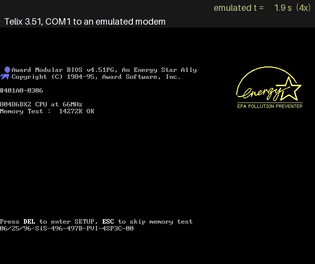

# Telix and a BBS through an emulated modem



A DOS terminal program talks to a BBS on the host as it would have in 1995: through a modem on
COM1. `serial_attach(peer="modem")` puts a Hayes-compatible modem on the VM's COM1, and its
phone line is TCP. `fakebbs.py` is the BBS.

Telix 3.51 dials `555-1234`, logs in, and then, with every result checked afterwards:

- **Echo:** lines typed come back.
- **Bulk text:** 200 numbered lines into Telix's capture file, byte for byte.
- **Downloads:** an 8 KiB test file by XMODEM-CRC and by XMODEM-1K, both identical to the original.
- **Upload:** the file goes back by XMODEM, and the BBS reports the right CRC-32.
- **Hang-up:** Telix drops DTR, the modem hangs up and reports NO CARRIER.

The bulk-text step is what found that input to the guest has to be paced: 86Box's UART polls its
backend once per bit time, so bytes sent all at once reached the guest up to ten times faster
than its line rate, and Telix lost lines while writing the capture file. 86Box's `automation`
serial backend now hands the guest one character per character time at the baud rate it has set.

## Running it

1. **Install Telix** on a DOS VM (made with `dos_create_vm`, say). Telix 3.51 is shareware; the
   archive.org copy is at <https://archive.org/details/TelixCommunications_1020>. Put its files
   in `C:\TELIX` with `dos_install_files`. On first start, Telix asks for the COM port (COM1) and
   the modem type (a generic Hayes modem); the defaults otherwise work.

2. **Start the BBS** on the host:

   ```
   python examples/telix/fakebbs.py --log bbs.log --files .
   ```

   It listens on 127.0.0.1:2323 and logs every byte each way. Uploads are saved as `UPLOAD.BIN`.

3. **Start the VM with COM1 on the automation socket, and attach the modem:**

   ```
   vm_start(vm_dir=..., serial=[1])
   serial_attach(port=1, peer="modem", dial={"5551234": "127.0.0.1:2323"})
   ```

   Telix's `ATDT 555-1234` then connects to the BBS (the modem ignores the dash). `ATDT
   127.0.0.1:2323` would dial the address directly.

4. **Drive Telix** with the keyboard tools: `Alt+D`, then `M` for a manual dial. At the BBS menu,
   `E` echoes, `L` sends the lines (`Alt+L` starts a capture first), `D` and `K` start downloads
   (`PgDn`, then the protocol), and `U` waits for an upload (`PgUp`). `Alt+H` hangs up.
   `serial_status` shows the modem's state, its recent events and the bytes moved.

## The modem

The modem answers the AT commands a terminal program sends when it sets up and dials: `Z`, `E`,
`V`, `Q`, `H`, `O`, `A`, `I`, `S` registers, `&F`, `&C` and `&D`. Others are accepted with `OK`.
`CONNECT` reports the guest's own baud rate.

- **While a call is up:** DCD is raised.
- **Back to command mode:** `+++`, with the guard time from S12.
- **Hang-up:** on `ATH`, when the guest drops DTR (`&D2`), or with `NO CARRIER` when the far end
  closes the connection.
- **Failed calls:** a refused connection gives `BUSY`, and a number with no mapping gives `NO
  ANSWER`.
