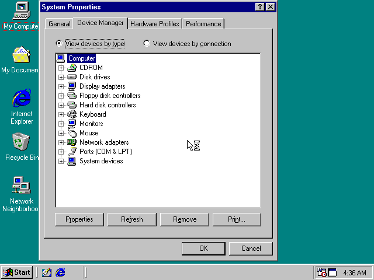

# 86box-mcp and V9x Remote Agent on one Windows 98 VM

[V9x Remote Agent](https://github.com/michaeldale/V9x-Remote-Agent) is an
agent program that runs *inside* Windows 9x and gives an MCP client commands,
files, screenshots and input through the guest's own Windows APIs. 86box-mcp
works from *outside*, at the hardware. This example installs Windows 98 and the
agent into an 86Box VM, then drives that VM through **both MCP servers at
once** and records which combinations work.

`crossover.py` is the demonstration: an MCP client that connects to both
servers over stdio, runs the scenarios below, captions the 86Box recording as
it goes, and writes `out/results.md`.

## Setting it up

### 1. Windows 98 install media

We used [Windows 9x QuickInstall](https://github.com/oerg866/win98-quickinstall)
(`win98qi`), a bootable ISO that copies a pre-patched Windows 98 SE onto the
disk in a few minutes. Its DOS boot floppy chains straight into it, so with the
floppy and the ISO both inserted, no BIOS boot-order changes are needed. Any
Windows 98 SE media works; you need your own licence.

### 2. The VM

Create it from an `86box.cfg` for a Pentium-class machine, with the new
`config` parameter. Ours was a Socket 7 board (`p55t2p4`), Pentium MMX 233,
**128 MB**, S3 Trio64 PCI, SB16, PS/2 mouse, a 1 GB IDE disk and an ATAPI
CD-ROM, with `cpu_use_dynarec = 1`. On our host the interpreter ran Windows 98
at about a third of real time (4 s of emulated time took 12.6 s); the
recompiler took 6.6 s. Add the network card and the port forward
V9x needs, exactly as V9x's own 86Box quickstart says:

```ini
[Network]
net_01_card = ne2kpnp
net_01_net_type = slirp

[SLiRP Port Forwarding #1]
0_protocol = tcp
0_external = 9869
0_internal = 9869
```

Then:

```
vm_create(vm_dir, cylinders=2080, config="win98-template.cfg", nvr="<a saved CMOS for that machine>")
```

SLiRP is 86Box's user-mode NAT: the guest gets `10.0.2.15` by DHCP, Windows 98
detects the NE2000 PnP card by itself, and the forward makes the agent's port
appear on the host. **It listens on every host address, not just localhost**
(`0.0.0.0:9869`), and V9x's protocol has no authentication, so firewall it.
pcap, TAP and VDE would bridge the guest onto your LAN; V9x's docs say not to.

### 3. Install Windows 98 and the agent

Boot with the QuickInstall floppy and ISO inserted (`floppy_insert`,
`cdrom_insert`). In QuickInstall: `[DISK]` to partition the blank disk with
cfdisk (capital `W` writes the table), then `[INSTALL]` with the defaults. Five
minutes of emulated time later, eject both and reboot to the desktop.

Insert `V9XREMOTE.ISO` from a V9x release, run `D:\SETUP.EXE` (Start > Run;
AutoPlay didn't fire for us), accept the defaults, Install, Finish with
"Restart Windows now" ticked. After the restart the agent starts with Windows
and sits in the tray.

`record_start` before booting captures the whole install; ours rendered to a
38-second video.

### 4. Both servers at once

```sh
claude mcp add 86box -- /path/to/86box-mcp/server/.venv/bin/box86mcp
claude mcp add v9x -- python /path/to/V9x-Remote-Agent/mcp/v9x_mcp.py --host 127.0.0.1 --port 9869
```

`v9x_mcp.py` needs nothing beyond the Python standard library. Start the VM
with 86box-mcp's `vm_start`, `release`, and `v9x_wait_desktop`.

## The one rule: V9x needs emulated time to pass

The agent is a TCP server inside the guest. While 86box-mcp holds the machine,
the guest's TCP stack is frozen, so every V9x call times out. Three ways to
work:

- **`release`**, then use V9x freely in real time. `hold` again for exact
  steps, memory and frames.
- **Stay held and `step`**: a V9x request sent while a `step` is running
  completes inside the step. The machine is still held afterwards.
- **After a V9x action, `hold` and step frame by frame** to examine what it
  did.

## Pacing V9x calls around held time

V9x's agent only makes progress while emulated time passes, and calls sent
while the machine is held don't fail cleanly. We measured what happens
(V9x 0.9.1, with `pacing_backlog.py`):

- **SLiRP accepts on the host at once.** Its listener runs on a host thread,
  so `connect` succeeds even while held, and the request is buffered. SLiRP's
  own clock and timers run on emulated time, so it doesn't retransmit while
  held, and 40 queued calls didn't overflow 86Box's 16-packet receive queue.
- **The calls time out on the host,** after the V9x client's `--timeout`, but
  the guest still receives them later.
- **On release, the backlog arrives at once.** The agent takes at most 4
  connections at a time (`V9X_MAX_CONNECTIONS`) and closes any extra
  (`client-overflow` in `C:\V9XREMOTE\AGENT.LOG`). For about a second, until
  the dead connections are served, new calls fail fast with "peer closed the
  connection". This happened with every backlog from 5 to 40 calls; one call
  queued while held caused no failure.
- **A hold during a transfer is harmless if it's shorter than the timeout.** A
  900 KB download held for 4 s, with an 8 s timeout, finished normally. Held
  for 15 s it timed out, and the next ping worked at once.

So:

- **Don't send V9x calls while held.** `release` first, or send the call while
  a `step` runs, with a margin: a ping fits easily in a 4 s step, and a large
  transfer needs more.
- **Don't run more than 4 V9x calls in parallel.**
- **After calls have timed out while held,** release, then retry
  `v9x_ping` after a 1 s pause until it answers, before the next real call.
- **Retry once on "peer closed the connection"** after a 1.5 s pause.
  `crossover.py` does this.
- **Hold briefly during transfers,** or raise V9x's `--timeout` to cover the
  hold.

## What works together (from `crossover.py`)

| Scenario | Result |
|---|---|
| Boot held, `record_start`, `release`, `v9x_wait_desktop`, `v9x_ping` | works |
| `v9x_ping` while held | times out, by design |
| `v9x_ping` sent during `step(4000)` while held | works; the machine is still held afterwards |
| `vm_info` vs `v9x_inventory` | agree: 86Box reports 128 MB, the guest sees 127 MB |
| `v9x_screenshot` vs `screenshot` | the same desktop; only the pointer differs |
| `screen_text` on the Windows desktop | not a text mode, by design; V9x is the way to read text |
| `v9x_put_file`, then `v9x_shell TYPE` | works |
| `dos_install_files` while Windows runs | refused, by design: 86box-mcp's disk tools need the VM stopped |
| V9x opens a file in Notepad, 86box-mcp `find_memory` for its text | works: found in RAM in about 7 s |
| `hold`, then `step(20)` five times with Notepad open | works: 6 frames in 100 ms |
| 86box-mcp `type_text` into Notepad, V9x closes it and answers the save prompt, `v9x_get_file` | works |
| `v9x_move` to (100,100), 86box-mcp `mouse(dx=40)`, V9x reports the pointer | works: 40 counts moved it 40 px, and V9x can read the pointer position back |
| `cdrom_insert(files=...)`, then `v9x_list_dir D:\` | works |
| `reset(hard)`, then `v9x_wait_desktop`; boot counter up by one | works |

What each side is for, in short: use **86box-mcp** for time (hold, exact
steps), frames from the video card, physical memory, media, resets and
recordings; use **V9x** for running programs with exit codes and output, file
transfer while Windows runs, reading text, and pointer placement with a
read-back.

## The hardware's view against Windows' view

`hwview.py` takes two inventories of the same PC and matches them. From
outside, 86box-mcp scans the PCI bus through the debugger (`pci_scan`, as a
driver would, through ports 0xCF8/0xCFC). From inside, V9x has `regedit`
export Windows' Plug and Play tree (`HKLM\Enum`) and fetches it. The question
it answers is the one you ask when you emulate a device: did the guest find
it, where, and as what?

```sh
BOX86_BINARY=<86Box built with -D GDBSTUB=ON> BOX86_ROMS=... python examples/v9x/hwview.py
```

It needs the debugger build (see
[driver development](../../docs/driver-development.md#setting-up-the-debugger)).
On our VM, every PCI function matched a Windows device at the same bus, device
and function:

| 86Box (`pci_scan`) | Windows (`HKLM\Enum\PCI`) |
|---|---|
| `00:00.0 8086:1250` bridge | Intel 82439HX Pentium(r) Processor to PCI bridge |
| `00:07.0 8086:7000` bridge | Intel 82371SB PCI to ISA bridge |
| `00:07.1 8086:7010` storage | Intel 82371SB PCI Bus Master IDE Controller |
| `00:0c.0 5333:8811` display, IRQ 10 | S3 Trio32/64 PCI (732/764) |

Windows also lists four "IRQ Holder for PCI Steering" entries under PCI; they
are its interrupt routing, not devices. The other configured devices:

| 86Box (`86box.cfg`) | Windows |
|---|---|
| network card `ne2kpnp` | Realtek RTL8019 PnP LAN adapter (`ISAPNP\RTL8019`) |
| sound card `sb16` | **not found** |
| PS/2 keyboard and mouse | Standard 101/102-Key keyboard, Standard PS/2 Port Mouse |
| floppy, IDE hard disk, ATAPI CD-ROM | GENERIC NEC FLOPPY DISK, GENERIC IDE DISK TYPE47, 86Box 86B_CD00 |

The SB16 isn't Plug and Play, and this install never detected it. Device
Manager agrees: it has no sound category.



The script also reads two registers through the debugger, as the hardware
holds them: the S3 card's BAR0 (`e7000000`), and the VGA miscellaneous output
register at port 0x3CC (`0xef`).

## Things we hit

- **A copied `86box.cfg` carries its `uuid`.** With a network card configured,
  86Box treats a known uuid in a new folder as a moved or copied machine and
  stops at a dialog *before* starting the emulator thread. Headless, that's an
  invisible hang: the automation socket listens and connects but never answers.
  `vm_create(config=...)` now drops `uuid` and `mac` lines from the template.
- **`cfdisk` writes with capital `W`.** Lowercase `w` does nothing, and the
  Enter after it selects Quit.
- **V9x's `Ctrl+S`** didn't save in Notepad; closing with `Alt+F4` and answering
  the prompt did.
