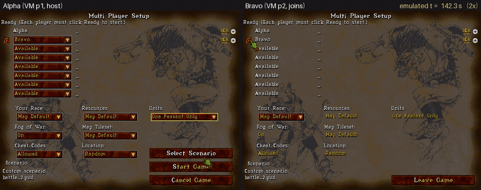

# Warcraft II over IPX: two 86Box VMs in lockstep



Two DOS machines in one MCP server, joined by 86Box's local network switch, play a two-player
Warcraft II game over IPX. Both boot from power-on, start the game, meet in the lobby and start
a game on `battle_2.pud` with one peasant each. Alpha's peon walks across the map to Bravo's base
and kills Bravo's peasant: Victory on one screen, Defeat on the other.

The machines are held throughout. Their clocks only advance in tool calls, and every call that
advances one advances both, 10 ms at a time, so neither game sees its peer stall. The video is
`record_stop_all`'s output, with both screens paired by emulated time.

## What it needs

- **Warcraft II v1.2 or later for DOS.** This demo used "Warcraft 2X RETAIL v1.50", the version
  eXoDOS ships, plus the game CD, which the game checks for. Version 1.0 can create IPX games, but
  no one can join them; Blizzard fixed that in 1.2.
- **MS-DOS 6.22's HIMEM.SYS and MSCDEX.EXE**, plus an ATAPI CD-ROM driver (VIDECDD.SYS), a mouse
  driver (CuteMouse's CTMOUSE.EXE) and Novell's ODI drivers for an NE2000 (LSL.COM, NE2000.COM and
  IPXODI.COM).

## Running it

1. **Build one VM, then copy it.** The copy is p1 and p2:

   ```
   BOX86_DOS_BASE_IMG=... python examples/warcraft2/prepare.py --out WORK/p1 \
       --dos-files DOSFILES --net-kit NETKIT --mouse CTMOUSE.EXE --war2x WAR2X
   cp -r WORK/p1 WORK/p2
   sed -i '/^mac/d;/^uuid/d' WORK/p2/86box.cfg
   ```

   Each VM gets an NE2000 at port 300, IRQ 3, on 86Box's local switch (`net_01_net_type =
   nlswitch`). Their shared `net_01_secret` puts them on one segment. A copied VM must not keep
   the original's MAC address, hence the `sed`.

2. **Get both players into the lobby.** Start `python -m box86mcp.ctl serve`, then run:

   ```
   examples/warcraft2/lobby.sh WORK GAME_CD.cue
   ```

   The script boots both VMs and records each from power-on. It starts the game on both and names
   the players Alpha and Bravo. Alpha creates an IPX game on `battle_2.pud`, and Bravo joins and
   clicks Ready.

3. **Play the rest by hand**, through the server's tools:
   - **Units:** open the dropdown on p1 with `mouse(left=True, release=False)`, look at the open
     list, then move onto "One Peasant Only" and let go.
   - **Start Game:** press it on p1.
   - **Walk:** select the peon, then right-click Bravo's base on the minimap. Bravo starts at tile
     (31, 54); the minimap shows 2 pixels per tile from (24, 25).
   - **Fight:** right-click Bravo's peasant to attack it.

4. **Render the video:**

   ```
   record_stop_all(video="warcraft2.mp4", speed=["0:4", "75000:2", "143000:1"])
   ```

   The speed list plays the boot at 4x, the lobby at 2x and the game at real speed. Each VM's
   panel shows its own frames; the clock above them is the emulated time they share.

## What it took

- **Stepping together.** A tool acting on one VM used to advance only that one. The other VM
  froze, and the host's game dropped it ("Game was terminated by the game creator"). Now held VMs
  in a group step together whichever one a tool acts on, and a separate group runs on its own.
  See `vm_group`.
- **Pointing in an RTS.** `mouse_to` parks the pointer in a corner first. That scrolls the map,
  so in the game the pointer moves by relative `mouse(dx, dy)` steps, checked with screenshots
  (about 1.5 pixels per count here). The hotspot is the gauntlet's fingertip, top left.
- **Picking a map.** A parser for the map files' `DIM`, `UNIT` and `SQM` chunks found the stock
  two-player maps whose start locations a land path joins. Garden of War, the classic 1v1 map,
  came with the 1999 Battle.net Edition and isn't on the DOS discs.
