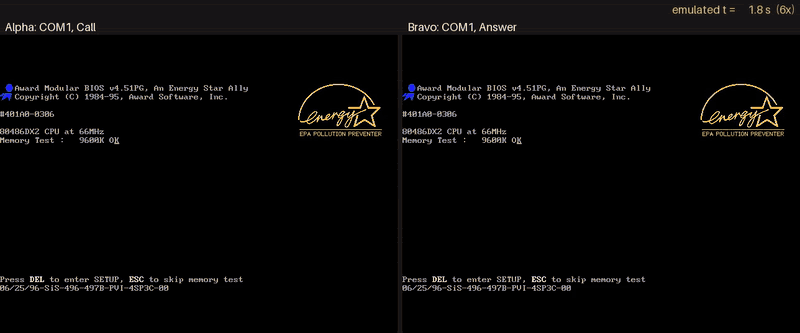
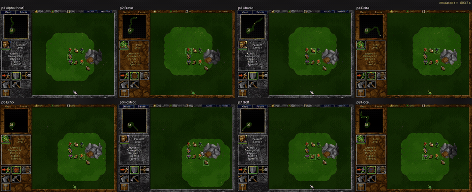

# Warcraft II over IPX: two 86Box VMs in lockstep


Two DOS machines in one MCP server, joined by 86Box's local network switch, play a two-player
Warcraft II game over IPX. Both boot from power-on, start the game, meet in the lobby and start
a game on `battle_2.pud` with one peasant each. Alpha's peon walks across the map to Bravo's base
and kills Bravo's peasant: Victory on one screen, Defeat on the other.

The machines are held throughout. Their clocks only advance in tool calls, and every call that
advances one advances both, 10 ms at a time, so neither game sees its peer stall. The video is
`record_stop_all`'s output, with both screens paired by emulated time.

## What it needs

- **Warcraft II v1.2 or later for DOS.** This demo used "Warcraft 2X RETAIL v1.50", the version
  eXoDOS ships, plus the game CD, which the game checks for. Version 1.0 can create IPX games, but
  no one can join them; Blizzard fixed that in 1.2.
- **MS-DOS 6.22's HIMEM.SYS and MSCDEX.EXE**, plus an ATAPI CD-ROM driver (VIDECDD.SYS), a mouse
  driver (CuteMouse's CTMOUSE.EXE) and Novell's ODI drivers for an NE2000 (LSL.COM, NE2000.COM and
  IPXODI.COM).

## Running it

1. **Build one VM, then copy it.** The copy is p1 and p2:

   ```
   BOX86_DOS_BASE_IMG=... python examples/warcraft2/prepare.py --out WORK/p1 \
       --dos-files DOSFILES --net-kit NETKIT --mouse CTMOUSE.EXE --war2x WAR2X
   cp -r WORK/p1 WORK/p2
   sed -i 's/^mac *=.*/mac = 00:00:02/;/^uuid *=/d' WORK/p2/86box.cfg
   ```

   Each VM gets an NE2000 at port 300, IRQ 3, on 86Box's local switch (`net_01_net_type =
   nlswitch`). Their shared `net_01_secret` puts them on one segment. A copied VM must not keep
   the original's MAC address, hence the `sed`. Give it a fixed one rather than deleting the
   line: without a MAC, 86Box draws a new one from the host's clock at every start, and Warcraft
   II's game setup depends on it (the races and start positions changed with it), so runs stop
   being repeatable.

2. **Get both players into the lobby.** Start `python -m box86mcp.ctl serve`, then run:

   ```
   examples/warcraft2/lobby.sh WORK GAME_CD.cue
   ```

   The script boots both VMs and records each from power-on. It starts the game on both and names
   the players Alpha and Bravo. Alpha creates an IPX game on `battle_2.pud`, and Bravo joins and
   clicks Ready.

3. **Play the rest by hand**, through the server's tools:
   - **Units:** open the dropdown on p1 with `mouse(left=True, release=False)`, look at the open
     list, then move onto "One Peasant Only" and let go.
   - **Start Game:** press it on p1.
   - **Walk:** select the peon, then right-click Bravo's base on the minimap. Bravo starts at tile
     (31, 54); the minimap shows 2 pixels per tile from (24, 25).
   - **Fight:** right-click Bravo's peasant to attack it.

4. **Render the video:**

   ```
   record_stop_all(video="warcraft2.mp4", speed=["0:4", "75000:2", "143000:1"])
   ```

   The speed list plays the boot at 4x, the lobby at 2x and the game at real speed. Each VM's
   panel shows its own frames; the clock above them is the emulated time they share.

## Over a null-modem cable



The same two VMs can play over a serial cable instead. `serial_link` joins p1's COM1 to p2's
with a null-modem cable, wired with full handshaking (RTS to CTS, DTR to DSR and DCD), which
Warcraft II needs. Both VMs are started with `vm_start(serial=[1])`, which puts COM1 on the
automation socket. Then:

```
examples/warcraft2/null_modem.sh WORK GAME_CD.cue [video.mp4]
```

It boots both VMs, starts the game, and picks Direct Connect on COM 1 (the game fills in IRQ 4).
Bravo answers and Alpha calls; they exchange a line in the lobby, Bravo clicks Ready, Alpha
starts the game, and Bravo surrenders: Victory on one screen, Defeat on the other. With a video
file, it records both from power-on and renders them side by side.

Each byte crosses the cable after the lockstep quantum in which it was sent (10 ms) and reaches
the other guest at the baud rate its UART is set to. Everything happens in emulated time, so two
runs give the same bytes both ways (`serial_links` prints the counts: 1908 from Alpha, 1301 from
Bravo here) and the same final screens. That needs fixed MACs (see step 1 above): the network
cards stay in the VMs, the IPX driver still loads, and the game's setup changes with p2's MAC.

## What it took

- **Stepping together.** A tool acting on one VM used to advance only that one. The other VM
  froze, and the host's game dropped it ("Game was terminated by the game creator"). Now held VMs
  in a group step together whichever one a tool acts on, and a separate group runs on its own.
  See `vm_group`.
- **Pointing in an RTS.** `mouse_to` parks the pointer in a corner first. That scrolls the map,
  so in the game the pointer moves by relative `mouse(dx, dy)` steps, checked with screenshots
  (about 1.5 pixels per count here). The hotspot is the gauntlet's fingertip, top left.
- **Picking a map.** A parser for the map files' `DIM`, `UNIT` and `SQM` chunks found the stock
  two-player maps whose start locations a land path joins. Garden of War, the classic 1v1 map,
  came with the 1999 Battle.net Edition and isn't on the DOS discs.

## Eight players



How Warcraft II reads the mouse, and the traps in automating it, are in
[docs/input-quirks.md](../../docs/input-quirks.md#warcraft-ii-dos-v150-2x).

The same setup with eight VMs (p1 to p8, copies of one VM, each with its own fixed `mac` and no `uuid`) on
`plots.pud`, with CuteMouse and MOUSEBOX (examples/touch) in AUTOEXEC.BAT so `mouse_to` puts the
pointer anywhere. The video runs from power-on to the end of the fight.

- **The lobby:** p1 creates the game. The Players filter set to "5 to 8" puts PUDS straight into
  the list, and plots.pud is the sixth entry in PUDS\MULTI. The others join, and each ticks
  every Ready box, since only their own responds and the rows follow the order of joining.
- **Simultaneous joins dropped a player:** twice, with all seven joining and clicking Ready in the
  same instant, one player was dropped as the game started ("Player Hotel was dropped" on seven
  screens, "Player Golf was dropped" on Hotel's). With joins and Ready clicks a second or so
  apart, all eight stayed in. That's three runs, so a likely trigger rather than a proven one,
  and possibly a Warcraft II bug that people never hit.
- **The walk:** Warcraft II's pathfinding gives up on long orders, so we planned each route on the
  map's terrain grid (the PUD's SQM chunk) and sent each peon one leg at a time, about 14 tiles,
  with the Move button and a click on the minimap. Before each leg, each player's own unit was found
  on its minimap (pure green, 0,255,0) and the route replanned from there. All eight arrived in
  four legs.
- **The chase:** a ring a few tiles wide where each peon attacks its clockwise neighbour never
  fights: everyone chases a target that runs at the same speed after its own. The fight happens
  with the eight on the tiles round one centre tile, each already next to its target.
- **Traps on the way:**
  - **The pointer hides the minimap:** after a minimap click the gauntlet covers the unit dots,
    so move it away before looking.
  - **The screen's edges scroll the map:** don't park the pointer there.
  - **Gold mines don't show in the terrain grid**, so a planned tile next to one may be
    unreachable.
